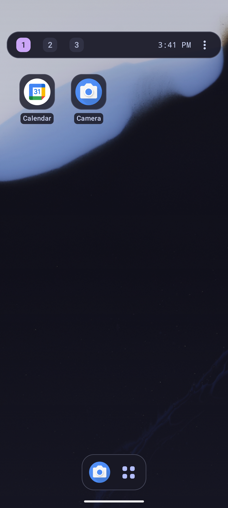
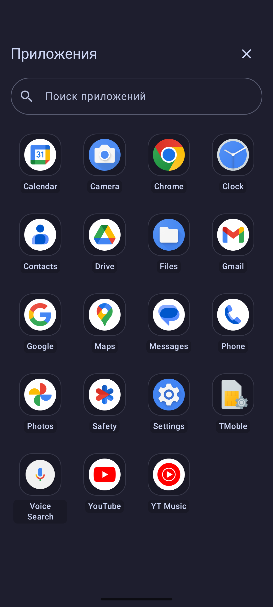
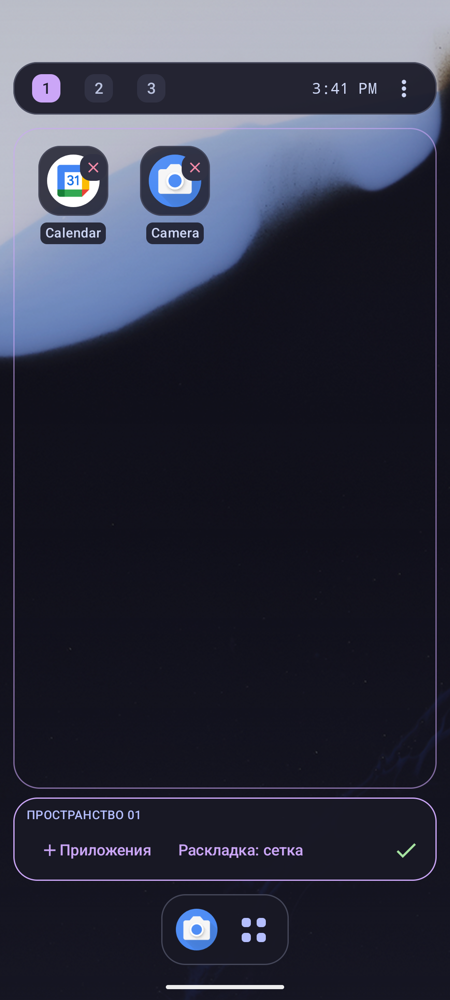
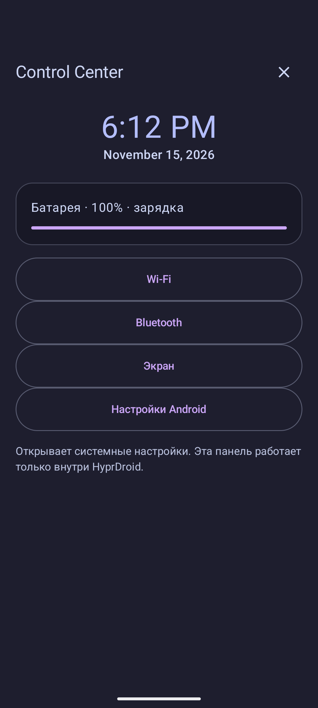
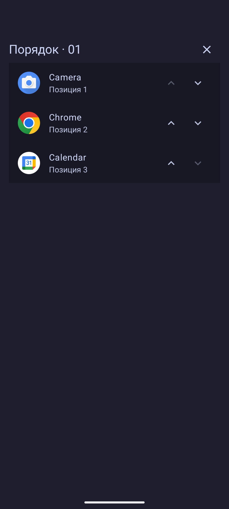
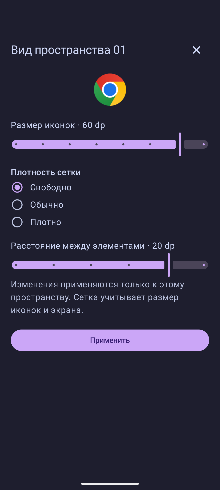

# HyprDroid Mobile

HyprDroid — экспериментальная Android HOME-оболочка, вдохновлённая Hyprland. Рабочие пространства, компактные панели и настраиваемый фон адаптированы для сенсорного экрана. Root, Shizuku, ADB и разблокировка загрузчика для использования не требуются.

Минимальная версия Android — **10 (API 29)**. Версия интерфейса — **0.4.1**. Проект находится на ранней стадии; сведения о проверенных сборках и ограничениях тестирования находятся в [руководстве по сборке](docs/BUILD.md).

## Возможности

- Три независимых рабочих пространства с сохранением закреплений и переключением свайпами.
- Компактная панель в стиле Waybar: индикаторы пространств, часы и меню.
- Dock до четырёх избранных приложений, общий для пространств.
- Полноэкранный drawer с поиском, прокруткой, настоящими иконками и запуском приложений текущего профиля.
- Редактирование пространства и контекстные меню приложений вместо постоянных кнопок на домашнем экране.
- Системные/живые обои или выбранное изображение; начальная палитра Catppuccin Mocha.
- DataStore сохраняет закрепления, выбранное пространство, Grid/List, dock и фон между перезапусками.
- Обновление каталога приложений, обработка удаления пакетов и ошибок хранения/запуска.
- Жесты свободной области: вверх — drawer, вниз — Control Center с часами, датой, батареей и переходами в настройки Android.
- Сохраняемый порядок иконок, перестановка и атомарный перенос между пространствами через контекстные действия.
- Независимые Grid/List, размер иконок, плотность сетки и интервалы каждого workspace.

Рабочие профили, Widget Engine, drag-and-drop и импорт dotfiles пока не реализованы. Сроки будущих этапов не установлены; см. [ROADMAP](docs/ROADMAP.md).

## Управление

- **Пространства:** горизонтальный свайп по рабочему полю или нажатие индикатора верхней панели.
- **Все приложения:** свайп вверх по свободной области, кнопка с четырьмя квадратами в dock или пункт меню верхней панели.
- **Control Center:** свайп вниз по свободной области или пункт меню панели. Это экран HyprDroid; кнопки открывают стандартные настройки, не заменяя SystemUI.
- **Обратный жест:** drawer закрывается свайпом вниз, Control Center — вверх. В содержимом жест закрывает панель только при начале у границы прокрутки (верх drawer, низ Control Center). По заголовку панель можно закрыть в любой позиции списка. Поиск, кнопки X и Back остаются доступны.
- **Редактор:** долгое нажатие пустой области либо «Редактировать пространство» в меню панели. Здесь можно добавить приложения, снять закрепления и переключить Grid/List. «Готово» или Back закрывает редактор.
- **Меню приложения:** долгое нажатие иконки. Позволяет закрепить/убрать приложение в текущем пространстве и добавить/убрать его из dock. Обычное нажатие запускает приложение.
- **Добавление в редакторе:** drawer открывается в режиме выбора закреплений; нажатие отмечает приложение. Одно приложение можно закрепить на нескольких пространствах. Снятие закрепления не удаляет установленное приложение.
- **Обои:** пункты «Выбрать изображение…» и «Системные обои» в меню панели. Доступ предоставляется только к выбранному файлу.
- **Порядок:** «Раньше/Позже» в контекстном меню или «Порядок элементов» в меню панели/редакторе. На отдельном экране используются кнопки со стрелками.
- **Перенос:** «Переместить в пространство 0N» в меню закреплённого приложения. Если приложение уже есть в цели, сохраняется одно закрепление на прежнем месте.
- **Вид:** «Вид пространства» в меню панели либо «Вид» редактора. Размер иконок, плотность и интервалы сохраняются только для выбранного пространства после «Применить»; Back отменяет черновик.

При первом запуске пространства и избранное пусты. Системный статус-бар временно показывается жестом от верхнего края; системная навигация остаётся доступной.

Жесты оболочки начинаются на свободной области вдали от краёв; касания иконок, кнопок, dock и прокрутка drawer сохраняют своё поведение. В редакторе вертикальные жесты отключены. Данные workspace v0.3 автоматически переходят на схему v2 с сохранением закреплений и прежней раскладки; у v0.3 не было сохранённого порядка, поэтому начальный порядок определяется компонентами. Dock и обои не мигрируются и сохраняются отдельно.

## Интерфейс

| Домашний экран | Все приложения | Редактор |
| --- | --- | --- |
|  |  |  |

Снимки с эмулятора Android 15; показаны стандартные приложения и обои эмулятора.

Новые экраны v0.4:

| Control Center | Порядок | Вид пространства |
| --- | --- | --- |
|  |  |  |

## Установка APK и смена лаунчера

1. Откройте [Android debug APK в GitHub Actions](https://github.com/PseudoEF/HyprDroid/actions/workflows/android.yml) и выберите успешный запуск нужной ветки/коммита.
2. В **Artifacts** скачайте **HyprDroid-debug-apk** и извлеките `app-debug.apk`. Для скачивания через GitHub может потребоваться вход в аккаунт. Artifact хранится 14 дней.
3. Откройте APK на Android 10 или новее, при запросе разрешите установку из выбранного источника.
4. Выберите HyprDroid в системных настройках домашнего экрана.

Это debug-сборка, не стабильный релиз. Сохраните установленный системный лаунчер. Чтобы вернуться к нему, откройте **меню верхней панели → Другой лаунчер**, либо **Настройки Android → Приложения → Приложения по умолчанию → Главный экран**. Названия пунктов зависят от устройства.

## Сборка из исходников

Нужны JDK 17 и Android SDK с пакетами `platform-tools`, `platforms;android-35`, `build-tools;34.0.0`. Укажите SDK через `ANDROID_HOME` или `sdk.dir` в локальном `local.properties`, который не следует коммитить.

```sh
git clone https://github.com/PseudoEF/HyprDroid.git
cd HyprDroid
./gradlew :app:testDebugUnitTest :app:assembleDebug --no-daemon --stacktrace
```

В Windows используйте `gradlew.bat`. Wrapper загружает Gradle 8.9 с проверкой SHA-256; нужен доступ к серверам Gradle, Google Maven и Maven Central. APK: `app/build/outputs/apk/debug/app-debug.apk`. В Android Studio выберите Gradle JDK 17.

## Ограничения Android

Обычный HOME-лаунчер без привилегированных оконных API не может произвольно перемещать, изменять размеры или встраивать окна сторонних приложений. Раскладки HyprDroid относятся к его собственным компонентам. Desktop Mode, TOML и управление чужими окнами не входят в v0.4.

## Документация

- [Техническое описание](docs/PROJECT.md)
- [Дорожная карта](docs/ROADMAP.md)
- [Сборка и тестирование](docs/BUILD.md)
- [История изменений](CHANGELOG.md)

## Лицензия

Лицензия проекта пока не выбрана; файл `LICENSE` отсутствует. Репозиторий не заявляет условия какой-либо открытой лицензии.
